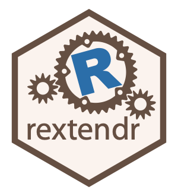

<!-- README.md is generated from README.qmd. Please edit that file -->

```{r}
#| include: false
knitr::opts_chunk$set(
  message = FALSE,
  collapse = TRUE,
  comment = "#>",
  fig.path = "man/figures/README-",
  out.width = "100%"
)
```

# Call Rust code from R 

<!-- badges: start -->
[](https://CRAN.R-project.org/package=rextendr)
[](https://extendr.r-universe.dev/rextendr)
[](https://lifecycle.r-lib.org/articles/stages.html#stable)
[](https://github.com/extendr/rextendr/actions)
<!-- badges: end -->

The `rextendr` package supports developers who want to build R packages that 
call Rust code with [extendr](https://github.com/extendr/extendr). See the 
[documentation](https://extendr.rs/) for more details.

## Installation

To install release version from CRAN, run:

```r
install.packages("rextendr")
```

or use `{remotes}`

```r
remotes::install_cran("rextendr")
```

You can also install `{rextendr}` from [r-universe](https://extendr.r-universe.dev/rextendr):

```{r}
#| output: false
install.packages(
  "rextendr",
  repos = c("https://extendr.r-universe.dev", "https://cloud.r-project.org")
)
```

Latest development version can be installed from GitHub:

```r
remotes::install_github("extendr/rextendr")
```

To execute Rust code, you will also need to set up a working Rust toolchain. See 
the [installation guide](https://extendr.rs/get-started.html) for help.

## Usage

```{r}
#| output: false
library(rextendr)
```

### Sitrep

A good first step is to check the status of Rust toolchain and available targets 
using `rust_sitrep()`. If everything is OK, you should see something like this:

```r
rust_sitrep()
# Rust infrastructure sitrep:
# ✔ "rustup": 1.26.0 (5af9b9484 2023-04-05)
# ✔ "cargo": 1.72.0 (103a7ff2e 2023-08-15)
# ℹ host: x86_64-pc-windows-msvc
# ℹ toolchain: stable-x86_64-pc-windows-msvc (default)
# ℹ target: x86_64-pc-windows-gnu
```

If, for instance, no toolchain is found, you will see something like this:

```r
rust_sitrep()
# Rust infrastructure sitrep:
# ✔ "rustup": 1.26.0 (5af9b9484 2023-04-05)
# ✔ "cargo": 1.72.0 (103a7ff2e 2023-08-15)
# ℹ host: x86_64-pc-windows-msvc
# ! Toolchain stable-x86_64-pc-windows-msvc is required to be installed and set as default
# ℹ Run `rustup toolchain install stable-x86_64-pc-windows-msvc` to install it
# ℹ Run `rustup default stable-x86_64-pc-windows-msvc` to make it default
```

Finally, if you are missing the required target (on all platforms but Windows 
`{rextendr}` uses default target), the report will resemble the following:

```r
rust_sitrep()
# Rust infrastructure sitrep:
# ✔ "rustup": 1.26.0 (5af9b9484 2023-04-05)
# ✔ "cargo": 1.72.0 (103a7ff2e 2023-08-15)
# ℹ host: x86_64-pc-windows-msvc
# i toolchains: nightly-x86_64-pc-windows-msvc and stable-x86_64-pc-windows-msvc (default)
# i targets: x86_64-pc-windows-msvc and i686-pc-windows-msvc
# ! Target x86_64-pc-windows-gnu is required on this host machine
# i Run `rustup target add x86_64-pc-windows-gnu` to install it
```

### Code examples

Basic use example:

```{r}
# create a Rust function
rust_function("fn add(a:f64, b:f64) -> f64 { a + b }")

# call it from R
add(2.5, 4.7)
```

Something more sophisticated:

```{r}
# Rust function that computes a sum of integer or double vectors, preserving the type
rust_function(
  "fn get_sum(x : Either<Integers, Doubles>) -> Either<Rint, Rfloat> {
      match x {
          Either::Left(x) => Either::Left(x.iter().sum()),
          Either::Right(x) => Either::Right(x.iter().sum()),
      }
  }",
  use_dev_extendr = TRUE, # Use development version of extendr from GitHub
  features = "either" # Enable support for Either crate
)

x <- 1:5
y <- c(1, 2, 3, 4, 5)

tibble::tibble(
  Name = c("x", "y"),
  Data = list(x, y),
  Types = purrr::map_chr(Data, typeof),
  Sum = purrr::map(Data, get_sum),
  SumRaw = purrr::flatten_dbl(Sum),
  ResultType = purrr::map_chr(Sum, typeof)
)
```

The package also enables a new chunk type for knitr, `extendr`, which compiles 
and evaluates Rust code. For example, a code chunk such as this one:

````markdown
`r ''````{extendr}
rprintln!("Hello from Rust!");

let x = 5;
let y = 7;
let z = x*y;

z
```
````
would create the following output in the knitted document:
```{extendr}
rprintln!("Hello from Rust!");

let x = 5;
let y = 7;
let z = x*y;

z
```

### Project scaffolding

To setup a project with extendr scaffolding, first initialize an R package
directory with `usethis::create_package()`. Then navigate to that directory and
call `rextendr::use_extendr()`.

```r
usethis::create_package("helloextendr")

rextendr::use_extendr()
# ✔ Setting active project to "./helloextendr".
# ℹ First time using rextendr. Upgrading automatically...
# ℹ Setting `Config/rextendr/version` to "0.5.0" in the DESCRIPTION file.
# ℹ Setting `SystemRequirements` to "Cargo (Rust's package manager), rustc >= 1.65.0, xz" in the DESCRIPTION file.
# ✔ Creating src/rust/src.
# ✔ Writing src/entrypoint.c.
# ✔ Writing src/Makevars.in.
# ✔ Writing src/Makevars.win.in.
# ✔ Writing cleanup.
# ✔ Writing cleanup.win.
# ✔ Writing src/.gitignore.
# ✔ Writing src/rust/Cargo.toml.
# ✔ Writing src/rust/src/lib.rs.
# ✔ Writing src/hellowworld-win.def.
# ✔ Writing R/extendr-wrappers.R
# ✔ Writing tools/document.R.
# ✔ Writing tools/msrv.R.
# ✔ Writing tools/config.R.
# ✔ Writing configure.
# ✔ Writing configure.win.
# ✔ Adding "^\\.vscode$" to .Rbuildignore.
# ✔ Writing .vscode/settings.json.
# ✔ Adding R to Depends field in DESCRIPTION.
# ✔ Adding "^src/\\.cargo$" to .Rbuildignore.
# ✔ Adding "^src/rust/vendor$" to .Rbuildignore.
# ✔ Adding "src/rust/vendor" to .gitignore.
# ✔ Adding "^src/rust/target$" to .Rbuildignore.
# ✔ Adding "^src/Makevars$" to .Rbuildignore.
# ✔ Adding "src/Makevars" to .gitignore.
# ✔ Adding "^src/Makevars\\.win$" to .Rbuildignore.
# ✔ Adding "src/Makevars.win" to .gitignore.
# ✔ Finished configuring extendr for package hellowworld.
# • Please run `devtools::document()` for changes to take effect.
# ℹ Call `use_extendr_badge()` to add an extendr badge to your README
```

The output is pretty lengthy, showing all the scaffolding files that are 
generated, along with the initiated Rust project in `src/rust/`. Some of this 
may change as we update and improve extendr tools, but the main thing to note 
here is that `devtools::document()` is sufficient to compile the hello-world 
example that `lib.rs` contains by default, generate the necessary wrappers, and 
build the R package. Then `devtools::load_all()` will make them available in 
your current R session.

```r
devtools::document()
devtools::load_all()

hello("world")
# [1] "Hello world!"
```

## See also

- The [cargo-framework](https://github.com/dbdahl/cargo-framework) and 
  associated R package [cargo](https://cran.r-project.org/package=cargo)
- The [r-rust](https://github.com/r-rust) organization

-----

Please note that this project is released with a 
[Contributor Code of Conduct](https://github.com/extendr/rextendr/blob/main/CODE-OF-CONDUCT.md). 
By participating in this project you agree to abide by its terms.
